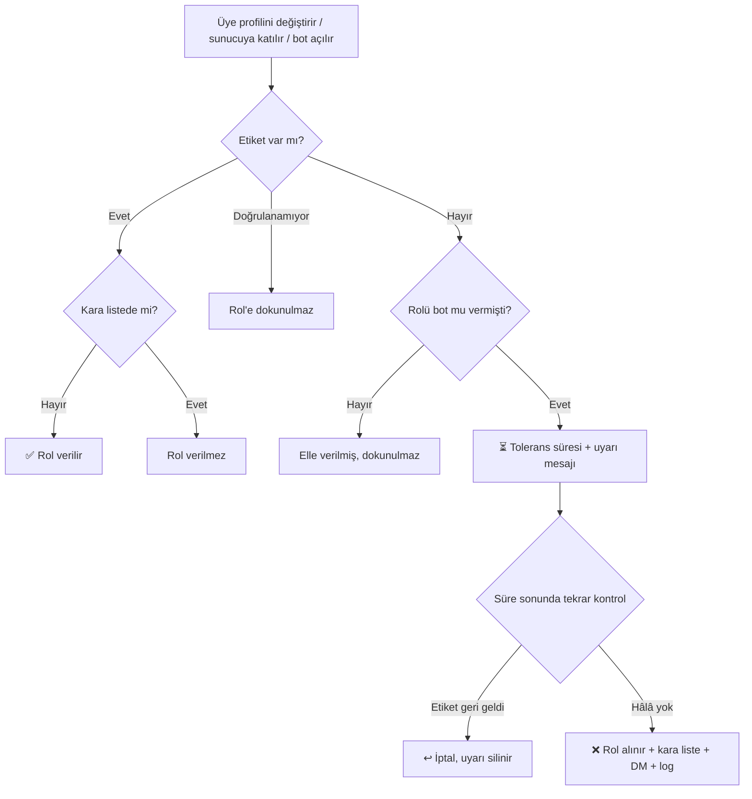

<div align="center">

# 🏷️ Discord Etiket Rol Sistemi Botu

**Etiket taşıyan üyelere otomatik rol verir, etiketi bırakanların rolünü güvenli şekilde geri alır.**

Discord'un resmi **Sunucu Etiketi** özelliğini, kullanıcı adı / global ad / özel durum etiketlerini,
tolerans süresini, süreli kara listeyi ve log sistemini destekler.

[💬 Destek Sunucusu (787)](https://discord.gg/CUFXct9PNz) • [👤 Geliştirici Profili](https://discord.com/users/1308888576091619365)

</div>

---

## 📑 İçindekiler
- [Özellikler](#-özellikler)
- [Nasıl çalışır?](#-nasıl-çalışır)
- [Kurulum](#-kurulum)
- [Ayarlar (.env)](#-ayarlar-env)
- [Slash komutları](#-slash-komutları)
- [Sunucu Etiketi (Guild Tag)](#-sunucu-etiketi-guild-tag)
- [Dosyalar](#-dosyalar)
- [Sık karşılaşılan sorunlar](#-sık-karşılaşılan-sorunlar)
- [Destek & İletişim](#-destek--iletişim)
- [Lisans](#-lisans)

---

## ✨ Özellikler

| | Özellik | Açıklama |
|---|---|---|
| 🏷️ | **Sunucu Etiketi desteği** | Discord'un resmi sunucu etiketini profilinde gösterenlere rol verir |
| 🔎 | **Çoklu etiket kaynağı** | Kullanıcı adı, global ad, özel durum (her biri ayrı ayrı açılıp kapatılır) |
| ⏳ | **Tolerans süresi** | Etiket silinince rol hemen alınmaz, `GRACE_MINUTES` sonra taze veriyle tekrar kontrol edilir |
| ⚠️ | **Uyarı mesajı** | Tolerans süresinde, ayrı bir kanala embed'siz düz mesajla kullanıcı uyarılır |
| 🛡️ | **Güvenli geri alma** | Sadece botun verdiği roller geri alınır, elle verilen rollere dokunulmaz |
| 📴 | **Çevrimdışı koruması** | Özel durum okunamıyorsa (çevrimdışı/görünmez) rol haksız yere alınmaz |
| ⛔ | **Süreli kara liste** | Etiketi silenler `BAN_DURATION_DAYS` boyunca rol alamaz, süre dolunca otomatik temizlenir |
| 📜 | **Log kanalı** | Rol verildi/alındı, kara liste, hatalar ve yönetici işlemleri embed olarak yazılır |
| 💌 | **DM bildirimi** | Rolü alınan kullanıcıya bilgi mesajı gider |
| 🔐 | **İzne bağlı komutlar** | Slash komutlarını varsayılan olarak sadece Yönetici izni olanlar görür |
| 🧰 | **Yönetim komutları** | `/kontrol`, `/yeniden-tara`, `/ban-listesi`, `/say` ve daha fazlası |

---

## 🔄 Nasıl çalışır?



**Önemli kurallar**
1. **Etiket bulunduysa** ve kullanıcı kara listede değilse rol verilir.
2. **Etiket bulunamadıysa** bot sadece kendi verdiği rolü geri almayı dener. Elle verilen rollere dokunmaz.
3. **Etiket doğrulanamıyorsa** (özel durum kontrolünde kullanıcı çevrimdışıysa, etiket listesi boşsa vb.) rol asla geri alınmaz.
4. Geri alma işlemi her zaman **tolerans süresinden sonra, taze veriyle** yeniden kontrol edilerek yapılır.
5. Rolü alınan kullanıcı (ayar açıksa) kara listeye girer ve DM ile bilgilendirilir.

---

## 🚀 Kurulum

### 1) Gereksinimler
- [Node.js](https://nodejs.org) **18 veya üzeri**
- discord.js **14.23.2 veya üzeri** (Sunucu Etiketi desteği için, `package.json` zaten bunu ister)

### 2) Discord Geliştirici Portalı
1. [Developer Portal](https://discord.com/developers/applications)'da bir uygulama oluştur ve **Bot** sekmesinden token'ı al.
2. **Bot > Privileged Gateway Intents** bölümünde şunları aç:
   - ✅ **Server Members Intent**
   - ✅ **Presence Intent**
3. Botu sunucuya şu yetkilerle davet et (`bot` ve `applications.commands` kapsamları):
   - **Rolleri Yönet**
   - **Kanalları Görüntüle** ve **Mesaj Gönder** (log/uyarı kanalları için)
   - **Mesajları Yönet** (etiket geri gelince uyarı mesajını silebilmesi için)
   - **Bağlantı Yerleştir** (embed'ler için)
4. Sunucu Ayarları > Roller'de **botun rolünü, verilecek rolün üstüne** taşı.

### 3) Botu çalıştır
```bash
# Proje klasörüne gir
cd Discord-Etiket-Kontrol-Botu-v2

# Paketleri yükle
npm install

# .env.example dosyasını .env olarak kopyala ve doldur
copy .env.example .env      # Windows
# cp .env.example .env      # Linux / macOS

# Başlat
node main.js
```

Bot ilk açılışta komutları Discord'a yükler ve tüm üyeleri bir kez tarar.

---

## ⚙️ Ayarlar (.env)

| Ayar | Zorunlu | Varsayılan | Açıklama |
|---|:---:|---|---|
| `TOKEN` | ✅ | | Bot token'ı |
| `GUILD_ID` | ✅ | | Botun çalışacağı sunucunun ID'si |
| `ROLE_ID` | ✅ | | Etiket taşıyanlara verilecek rolün ID'si |
| `CLIENT_ID` | ❌ | otomatik | Gerekmez, bot kendi ID'sini kullanır |
| `ADMIN_ROLE_ID` | ❌ | | Yönetici izni olmasa da komutları kullanabilecek ek rol |
| `LOG_CHANNEL_ID` | ❌ | | Log embed'lerinin gideceği kanal |
| `WARN_CHANNEL_ID` | ❌ | | Tolerans süresi uyarısının (düz mesaj) gideceği kanal |
| `CHECK_USERNAME` | ❌ | `false` | Kullanıcı adında etiket ara (`true` / `false`) |
| `CHECK_GLOBAL_NAME` | ❌ | `false` | Global adda etiket ara |
| `CHECK_CUSTOM_STATUS` | ❌ | `false` | Özel durumda etiket ara |
| `CHECK_GUILD_TAG` | ❌ | `false` | Discord Sunucu Etiketi'ni kontrol et |
| `GUILD_TAG_SERVER_ID` | ❌ | `GUILD_ID` | Hangi sunucunun etiketi aranacak |
| `ENABLE_BAN_SYSTEM` | ❌ | `false` | Etiketi silenleri kara listeye al |
| `BAN_DURATION_DAYS` | ❌ | `7` | Kara liste süresi (gün), `0` = süresiz |
| `GRACE_MINUTES` | ❌ | `10` | Rolü almadan önce beklenecek süre (dakika), `0` = hemen |
| `ENABLE_DM` | ❌ | `true` | Rolü alınana DM gönder |

**`.env`**
```env
TOKEN=BotTokeniniz
# CLIENT_ID artık gerekmiyor (bot kendi ID'sini kullanır). Yazarsan token'daki botla aynı uygulamanın ID'si olmalı
CLIENT_ID=
GUILD_ID=SunucuID
ROLE_ID=VerilecekRolID

# Slash komutlarını varsayılan olarak sadece "Yönetici" izni olanlar görür/kullanır.
# İsteğe bağlı: ek olarak bu role sahip olanlar da komutları kullanabilir
# (komutları görmesi için Sunucu Ayarları > Entegrasyonlar > Bot'tan bu role izin vermen gerekir)
ADMIN_ROLE_ID=

# İsteğe bağlı: olayların yazılacağı kanal (rol verildi/alındı, hatalar, yönetici işlemleri)
LOG_CHANNEL_ID=

# İsteğe bağlı: etiketi bulunamayan kullanıcıya tolerans süresi içinde uyarı mesajı atılacak kanal
# (embed'siz düz mesaj, kullanıcıyı etiketler; etiket geri takılırsa mesaj silinir)
WARN_CHANNEL_ID=

CHECK_USERNAME=true
CHECK_GLOBAL_NAME=true
CHECK_CUSTOM_STATUS=true
# Discord'un resmi "Sunucu Etiketi" özelliği (profilde gösterilen sunucu etiketi)
CHECK_GUILD_TAG=true
# Hangi sunucunun etiketi aranacak? Boş bırakırsan GUILD_ID (bu sunucu) kullanılır
GUILD_TAG_SERVER_ID=

# Etiketi silenleri kara listeye alma
ENABLE_BAN_SYSTEM=true
# Kara liste süresi (gün). 0 = süresiz
BAN_DURATION_DAYS=7
# Etiket bulunamayınca rolü almadan önce beklenecek süre (dakika). 0 = hemen
GRACE_MINUTES=10
# Rolü alınan kullanıcıya DM gönder
ENABLE_DM=true

```

---

## 🧭 Slash komutları

Komutları varsayılan olarak yalnızca **Yönetici** izni olanlar görür ve kullanır.
`ADMIN_ROLE_ID` verirsen o rol de kullanabilir (komutları görmesi için Sunucu Ayarları > Entegrasyonlar'dan izin vermen gerekir).

| Komut | Açıklama |
|---|---|
| `/etiket-ekle <tag>` | Metin etiketi ekler |
| `/etiket-kaldir <tag>` | Metin etiketini kaldırır |
| `/etiketler` | Kayıtlı etiketleri gösterir |
| `/say` | Etiketli / etiketsiz / doğrulanamayan üye sayıları, kara liste ve bekleyen işlemler |
| `/kontrol <kullanıcı>` | Kişinin **neden** rol aldığını/almadığını gösterir (hangi etiket, hangi kaynakta, kara liste, bekleyen işlem) |
| `/yeniden-tara` | Tüm üyeleri elle yeniden kontrol eder |
| `/ban-list-ekle <kullanıcı> [gun] [sebep]` | Kara listeye ekler ve rolü alır. `gun` boşsa `.env`'deki süre, `0` = süresiz |
| `/ban-list-kaldir <kullanıcı>` | Kara listeden çıkarır (etiketi varsa rol hemen verilir) |
| `/ban-listesi` | Kara listedekileri sebep ve bitiş süresiyle gösterir |

---

## 🏷️ Sunucu Etiketi (Guild Tag)

Discord'un resmi **Sunucu Etiketi** özelliği için `CHECK_GUILD_TAG=true` yap.

- Kullanıcı profilinde bu sunucunun etiketini **gösteriyorsa** rol verilir.
- Etiketi kaldırırsa ya da başka sunucunun etiketini seçerse tolerans süresinden sonra rol alınır.
- Başka bir sunucunun etiketini aramak için `GUILD_TAG_SERVER_ID` yaz (boşsa bu sunucu).
- Bu kontrol için `tags.json` listesi gerekmez. Liste boşsa sadece sunucu etiketine bakılır.
- Etiket değişikliği anlık yansımazsa `/yeniden-tara` ile elle kontrol ettirebilirsin.

> Metin etiketleriyle birlikte kullanılabilir: kaynaklardan **biri** bile etiketi bulursa rol verilir.

---

## 📁 Dosyalar

| Dosya | Açıklama |
|---|---|
| `main.js` | Botun tamamı |
| `tags.json` | Metin etiketleri, örn. `["klan", "tag"]` (otomatik oluşur) |
| `banlist.json` | Kara liste: kişi, sebep, ekleyen ve bitiş zamanı. Eski format (ID listesi) ilk açılışta otomatik aktarılır |
| `granted.json` | Botun rol verdiği kullanıcılar. İlk çalıştırmada, rolü olan ve etiketi bulunanlar "bot verdi" sayılır |
| `.env` | Gizli ayarların (kendi bilgilerinle oluşturursun, **kimseyle paylaşma**) |

> ⚠️ `.env` dosyasını ve token'ını asla paylaşma ve GitHub'a yükleme.

---

## 🛠️ Sık karşılaşılan sorunlar

<details>
<summary><b>❌ <code>DiscordAPIError[20012]: You are not authorized to perform this action on this application</code></b></summary>

Komutlar, token'daki botla uyuşmayan bir uygulama ID'siyle yüklenmeye çalışılmış demektir. Bu sürümde bot kendi ID'sini kullandığı için güncel `main.js` ile çıkmaz. `.env`'de `CLIENT_ID` yazıyorsa silebilir ya da aynı uygulamanın ID'sini yazabilirsin.
</details>

<details>
<summary><b>❌ <code>Used disallowed intents</code></b></summary>

Developer Portal > Bot sekmesinde **Server Members Intent** ve **Presence Intent** açık olmalı.
</details>

<details>
<summary><b>❌ <code>Missing Permissions</code> (50013), rol verilmiyor</b></summary>

Botun rolü, verilecek rolün **üstünde** olmalı ve botta **Rolleri Yönet** izni bulunmalı. Log kanalı açıksa hata orada da görünür.
</details>

<details>
<summary><b>🤔 Kullanıcı etiketi taşıyor ama rol almadı</b></summary>

`/kontrol <kullanıcı>` komutunu kullan. Etiketin hangi kaynakta bulunduğunu, kara listede olup olmadığını ve sebebini açıkça gösterir.
</details>

<details>
<summary><b>🤔 Çevrimdışı kullanıcının rolü neden alınmadı?</b></summary>

Özel durum çevrimdışı/görünmez kullanıcılarda okunamaz. Bot bu durumda etiketin silindiğini varsaymaz ve rolü haksız yere almaz. Kullanıcı çevrimiçi olunca tekrar kontrol edilir.
</details>

<details>
<summary><b>🤔 Komutlar görünmüyor</b></summary>

Komutlar varsayılan olarak sadece Yönetici izni olanlara görünür. Başka bir rol için Sunucu Ayarları > Entegrasyonlar > Botun komutları bölümünden izin ver.
</details>

---

## 💬 Destek & İletişim

- 💬 **Destek Sunucusu (787):** [discord.gg/CUFXct9PNz](https://discord.gg/CUFXct9PNz)
- 👤 **Geliştirici:** [Discord profilim](https://discord.com/users/1308888576091619365)

Hata bildirmek, öneri vermek veya yardım almak için destek sunucusuna katılabilirsin.

---

## 📜 Lisans

Bu proje **GNU Genel Kamu Lisansı v3.0 (GPL-3.0)** altında lisanslanmıştır.
Yazılımı özgürce kullanabilir, değiştirebilir ve dağıtabilirsiniz; ancak aynı lisans şartlarına uymanız gerekir. Ayrıntılar için [`LICENSE`](LICENSE) dosyasına bakın.
